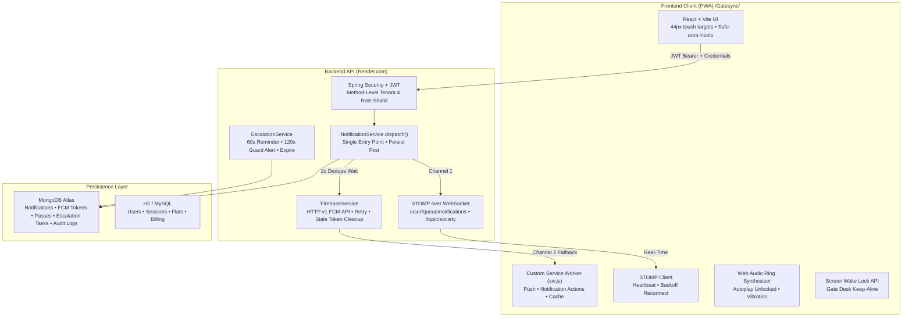
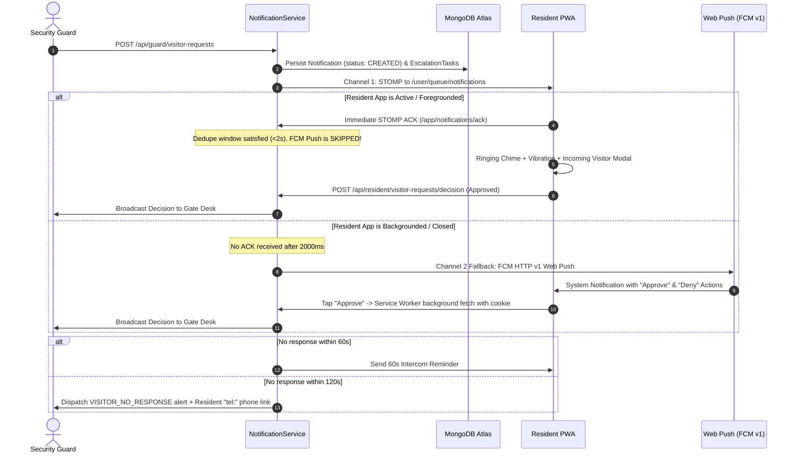

# GateSync — Production-Grade PWA & Residential Visitor Alerting Platform

GateSync is an enterprise, multi-tenant residential society security and visitor management platform. It pairs a **Spring Boot 3 (Java 21)** multi-tenant backend with a **React + Vite Progressive Web App (PWA)** deployed to GitHub Pages at `/Gatesync/`.

---

## 🏛️ System Architecture



---

## 🚀 Live Notification & Escalation Pipeline



---

## 🔑 Environment Variables

### Backend Configuration (Render / Production)

| Variable | Description | Default |
| :--- | :--- | :--- |
| `PORT` | Dynamic web port assigned by Render | `8080` |
| `MONGODB_URI` | MongoDB Atlas cluster connection string | `mongodb+srv://...` |
| `JWT_SECRET` | 256-bit HMAC SHA secret for JWT signing | Set in production |
| `FIREBASE_CREDENTIALS_JSON` | Firebase Admin Service Account JSON string for HTTP v1 Push | Optional (runs in simulation mode if blank) |
| `CLOUDINARY_CLOUD_NAME` | Cloudinary storage bucket | Optional |
| `CLOUDINARY_API_KEY` | Cloudinary API Key | Optional |
| `CLOUDINARY_API_SECRET` | Cloudinary API Secret | Optional |

### Frontend Configuration (`.env`)

| Variable | Description | Default |
| :--- | :--- | :--- |
| `VITE_API_BASE` | Backend API base URL | `https://gatesync-backend.onrender.com` |

---

## 🛠️ Testing Matrix & Verification Steps

### 1. Manual Testing Matrix

| Scenario | Steps to Verify | Expected Outcome |
| :--- | :--- | :--- |
| **STOMP Live Alert (App Open)** | 1. Open Resident tab on Flat A-101.<br>2. In Guard tab, check-in a visitor for Flat A-101.<br>3. Submit. | Full-screen incoming visitor modal appears on Resident screen within 500ms with ringing sound & vibration. |
| **FCM Push Fallback (App Closed)** | 1. Close the Resident browser tab.<br>2. Guard registers a visitor for Flat A-101. | After 2s dedupe window, browser receives Web Push with visitor photo and "✓ Approve" / "✕ Deny" actions. |
| **Direct SW Decision** | 1. Tap "✓ Approve" directly on the push notification banner. | Service worker executes atomic background decision. Guard screen turns green instantly with "Approved". |
| **Persistent Auth** | 1. Log in as Resident or Guard.<br>2. Hard refresh the page (`Ctrl + Shift + R`). | Session remains authenticated. No logout occurs. Access token silently refreshes. |
| **Emergency SOS** | 1. Resident taps floating red "SOS" button.<br>2. Countdown completes (or click trigger). | Guard screen displays high-priority red siren banner with sound and flat number. |
| **Pre-Approved Pass** | 1. Resident clicks "Create Pre-Approved Pass".<br>2. Guard clicks "Scan Pass / OTP" and enters the 6-digit code. | Clearance pass verified. Instant admission without intercom call. |

### 2. Automated Test Commands

```bash
# Frontend production build validation
npm run build

# Playwright E2E mobile approval flow
npx playwright test e2e/visitor-approval.spec.js

# Backend JUnit & Tenant Isolation tests (in Docker or Maven environment)
mvn test
```
